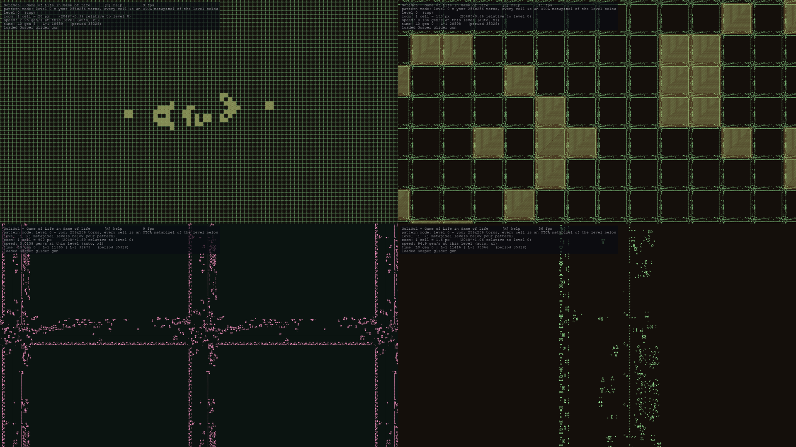

# GoLiGoL — Game of Life in Game of Life

An interactive, infinitely zoomable viewer of Conway's Game of Life **running
inside** Conway's Game of Life, built in Python (numpy + OpenGL).

Every cell you see is an [OTCA metapixel](https://conwaylife.com/wiki/OTCA_metapixel)
— a 2048 × 2048 Life pattern that behaves like a single Life cell, with a
period of 35 328 generations. Zoom into any cell and you find the metapixel
made of real Life cells. Each of those cells is again a metapixel, and so on,
with no bottom. In *tower mode* there is no top either: zoom out forever and the
picture repeats, like an infinite loop.

The simulation is **exact**: at every level and every instant, the cells on
screen are the true state of the Game of Life at that level. Nothing is drawn
"to look right". How this is possible without simulating 10^billions of cells
is explained below.



---

## Running it

Requirements: Python ≥ 3.9 and an OpenGL 3.3 GPU.

**Windows:** double-click `run.bat`. On first start it creates a virtual
environment and installs `numpy`, `pygame-ce` and `moderngl`.

**Linux / macOS:** `./run.sh`

Or manually:

```
pip install -r requirements.txt
python -m goligol                  # Gosper glider gun on a 256x256 torus
python -m goligol pattern.rle      # your own pattern (RLE)
python -m goligol --tower          # infinite tower: zoom out forever
python -m goligol --fullscreen
```

The window is DPI-aware (sharp on 4K screens). On Windows it is worth running
fullscreen (`F11`).

### Controls

| Input | Action |
|---|---|
| Mouse wheel, PgUp/PgDn | zoom towards the cursor — as deep as you like |
| Left drag | pan |
| Right drag | draw / erase cells (top level, pattern mode) |
| `Z` / `X` | auto-zoom in / out (toggle); `[` `]` change zoom speed |
| `Space` | pause / run; `.` = single generation of the viewed level |
| `+` / `-` | faster / slower; `A` = auto speed on/off |
| `1`…`9` | presets (glider, Gosper gun, R-pentomino, acorn, pulsar, LWSS, pentadecathlon, diehard, blinker) |
| `R` / `C` | random soup / clear |
| `T` | toggle **infinite tower** mode |
| `Ctrl+S` | save the level-0 pattern as RLE into `saves/` (file name with date and time) |
| `Ctrl+O` | open an RLE file; you can also drop an `.rle` file on the window |
| `G` | grid lines on/off (visible from 3 px per cell); `Home` = reset view; `H` = help; `Esc` = quit |

**Saving:** only *pattern mode* can be saved: `Ctrl+S` writes your level-0
universe (the pattern you drew or loaded) to `saves/pattern_YYYYMMDD_HHMMSS.rle`,
which you can load again with `Ctrl+O` or drag & drop, or open in Golly.
Tower mode cannot be saved: it has no top level and no pattern of its own, since
every level is the same built-in metapixel chain. The deeper metapixel levels are never
saved either, because they are always recomputed exactly from the pattern.
The grid (`G`) marks cell borders of the level you are viewing. The lattice you see
inside zoomed-in metapixels is not a grid but real Life cells: the metapixels'
own edge circuitry.

**Time follows zoom.** Each level down runs 35 328× faster than the one
above. With auto speed on, the level you are looking at always moves at a
watchable pace (≈ 180 gen/s when one cell is one pixel, ≈ 2 gen/s at
25 px/cell). Levels below it are a blur, and levels above are practically frozen.
The speed formula is continuous across level changes, so zooming never makes
time jump. `+`/`-` scale it; `A` switches to a fixed manual speed.

The HUD shows the mixed-radix clock: `L0 gen 12 | L-1 30411 | L-2 1205`
means level 0 is in generation 12, level −1 is at generation 30411 of the
current 35328-generation metapixel period, and so on.

### Modes

* **Pattern mode** (default): level 0 is your universe, a torus (default
  256×256, drawn with a faint outline). Edit it with the right mouse button
  or load presets / RLE files. Every cell of level 0 is a metapixel made of
  level −1 cells, those are made of level −2 cells, and so on, without end.
  Editing restarts time, so every level stays consistent.
* **Tower mode** (`T`): there is no top. The program found a *self-reproducing
  chain*: a metapixel context C, a phase g\* of its period, and a cell inside
  its 2048×2048 tile whose own context is again C at phase g\*. Every level
  above the ones you have touched is that chain, so zooming out never ends and
  every level looks the same. Press `X` and watch.

---

## How it works

### 1. The metapixel

The ON and OFF tiles are built from the original 2006 construction recipe
(Brice Due's design, written up as a script by Dave Greene and Andrew
Trevorrow in Golly's `metafier.py`). `tools/build_metacell.py` reads that script
as data (with Python's `ast`) and evaluates the construction with its own Life
engine. No Golly is needed.

### 2. A metapixel only depends on 11 bits

Simulating even one metapixel period at the next level down means
35 328 × 4 million cell updates per cell. Doing that recursively is out of the
question. What makes the whole program possible is this property, found and
verified experimentally:

> During one period, the full 2048×2048 contents of a metapixel are
> determined by its **context**: the current states of its 3×3
> neighbourhood (9 bits), its own *previous* state (1 bit), and a
> **honeybit** (1 bit). That is 2^11 = 2048 contexts.

At the start of each period a tile is one of exactly 8 bitmaps, the
*variants* (prev, cur, honeybit):

* `prev` is what the metapixel currently **displays** (interior full of
  heavyweight spaceships = on). `cur` is the state it has just computed. The
  display is redrawn to show `cur` about 5 000–9 000 generations into the
  period. So a metapixel's picture lags one meta-generation behind its logic.
* the honeybit is a 12-cell object at tile position (1925..1932, 105..112).
  It toggles whenever the cell is born: `hb' = hb xor (cur and not prev)`.

Checks run on these facts (`tools/`, and the database packer):
* functional dependence: every one of the 2048 contexts occurs twice, with
  different surroundings, in a 64×64 torus of metapixels. The two copies are
  identical (cells *and* birth parity) at every checkpoint;
* after a full period every tile is the variant predicted by applying Life's
  rule to the meta-cells (all 4096 tiles);
* the variants were derived by brute-force simulation (`tools/make_variants.py`)
  of an 8×8 torus of metapixels for four periods.

### 3. The context database

`tools/hl_db.c` is a small **HashLife** that simulates a 64×64 torus of
metapixels containing all 2048 contexts, for one full period. The cell state
is augmented with a second bit-plane, the *birth parity*
(`p' = p xor (s' and not s)`). That is still a local rule, so HashLife applies
unchanged. One period of the 2^17 × 2^17 torus takes ~2 minutes. Every 12
generations, each tile and its birth-parity plane are stored in a hash-consed
quadtree with 64×64 leaves. The result, `goligol/data/otca_db.npz` (55 MB),
contains every metapixel context at 2944 checkpoints. `tools/crosscheck.py`
checks the HashLife generator against a dense brute-force simulator
(`tools/gen_db.c`) bit for bit, cells and parity, at every checkpoint.

### 4. The tower

A level-L cell at time t is a metapixel whose context comes from level L+1.
To show any rectangle of any level exactly (`goligol/world.py`):

1. find the parent cells covering it, plus margins;
2. compute their contexts, recursively (parents need *their* parents, and so
   on up to the top, but the regions shrink by 2048× per level, so this is cheap);
3. assemble the checkpoint tiles from the database and run real Life
   (bit-parallel numpy, 64 cells per machine word) for the 0–12 generations
   since the checkpoint.

Time is a mixed-radix number: one digit (0…35327) per level. Advancing the
viewed level carries into its parents. The viewed level's region is kept in
memory and simply stepped with Life as time runs. It is rebuilt from the
database when you pan or zoom.

Rendering (`goligol/render.py`) is one fragment shader. It reads the packed
bits of the viewed level, computes every visible cell's context **on the
GPU**, and uses a context→layer table to sample a texture array that holds
the tiles of the level below at the current sub-generation (exact
live-cell density per pixel, down to single cells at the deepest zoom). At
2048 px per cell the overlay is pixel-identical to the next level down, so
level changes are seamless.

### Verification you can run

```
python -m pytest tests          # Life engine, RLE, tower consistency
tools/build_db.sh               # rebuild the database from scratch (~20 min, gcc)
python tools/crosscheck.py build/variants.bin build   # HashLife vs brute force
```

`tests/test_world.py` checks two things. Running Life on a region gives the
same result as asking the tower directly for the later time, at levels −1
and −2, including across period boundaries where the parent cell changes
state. And the tower's chain reproduces itself.

### Honest fine print

* **Honeybit history.** A cell's honeybit is its birth parity counted from the
  start of its *parent's* current period. The true value would also depend on
  the parent's whole history. Any honeybit value is a legal, exactly-evolving
  Life configuration, so every frame is genuine Life. A difference could only
  be seen if you watched level L−1 cells across a generation change of level
  L+1: 35 328² ≈ 1.2·10⁹ generations of the watched level, or about 80 days
  at auto speed.
* **Snapping.** When the viewed region has to be rebuilt (big pan or zoom
  jumps), its clock moves forward to the next checkpoint (+0…11
  generations), because rebuilding there is cheap. Time is never set
  backwards, and every displayed state is exact for the displayed time.
* The level-0 universe is a torus, so metapixel signals wrap around too,
  exactly as Life on a torus of meta-cells does.

---

## How this was made, and what is new

**This project is 100 % AI-generated.** All code, the database, the
documentation and the build-log posters were produced by an AI assistant
(Claude) in one session. A human (the repository owner) wrote the
specification and checked by hand that everything runs and looks right. The
correctness claims rest on the automated tests and cross-checks described
above, not on a human code review.

**What already existed (not part of this work):**
- the Game of Life (John Conway, 1970);
- the OTCA metapixel design (Brice Due, 2006), used unchanged;
- its construction recipe, Golly's `metafier.py` (Dave Greene and Andrew
  Trevorrow). It is **not** included in this repository, because it is part
  of Golly and under Golly's license. `tools/build_db.sh` downloads it when
  you rebuild the database, and only reads it as data, never executes it;
- the HashLife algorithm (Bill Gosper, 1984);
- the idea of zooming through levels of metapixels, made famous by
  Phillip Bradbury's video "Life in Life" (2012).

**What was written from scratch:** every other file. That covers the
bit-parallel Life engine, the C simulators, a HashLife implementation
extended with a birth-parity bit-plane, the tile database format, the tower
model (exact state of any level at any time), the GPU renderer, the app, and
the tests and cross-checks.

**What was worked out by experiment for this project:**
- the 11-bit context property (3×3 neighbourhood + previous state +
  honeybit determine a metapixel's whole period). Because the metapixel is
  designed to communicate only with its neighbours, this is expected rather
  than surprising;
- the 8 phase-0 variants and the role of the honeybit (it flips on each birth);
- the fact that a metapixel displays its previous state for the first part
  of each period;
- the self-reproducing chain (context 209) that allows endless zoom-out.

These may well be documented elsewhere. No search for prior work was done.

**How new is it?** It is a combination of known techniques, not a research
breakthrough. Running HashLife on an extra bit-plane is a standard trick, and
recording a cellular automaton's behaviour per local context is a known idea.
To the author's knowledge, an interactive viewer that is exact at every level
and every moment, with no bottom and (in tower mode) no top, is unusual. But
since prior work was not searched, it is not claimed to be the first.

## Files

```
goligol/
  life.py       bit-packed Life (numpy), RLE reader/writer
  tiledb.py     context database: quadtree expansion, density images
  world.py      the tower: contexts, mixed-radix time, exact regions, tower chain
  render.py     moderngl renderer (GPU context lookup, children overlay)
  app.py        window, camera, input, HUD, time control
  patterns.py   presets
  data/otca_db.npz   the 2048-context database (generated)
tools/
  build_metacell.py   OTCA ON/OFF tiles from Golly's metafier recipe (parsed as data)
  torus_sim.c         dense bit-parallel torus simulator (research / variants)
  make_variants.py    derive the 8 phase-0 variants by brute force
  make_layout.py      anneal a torus containing all 2048 contexts
  hl_db.c             HashLife database generator (2 bit-planes)
  gen_db.c            brute-force database generator (for cross-checking)
  pack_db.py          verify + pack the database, find the tower chain
  crosscheck.py       HashLife vs brute force
  build_db.sh         full pipeline
tests/
```

Credits: OTCA metapixel by Brice Due (2006). Metafier script by Dave Greene
and Andrew Trevorrow (Golly).
